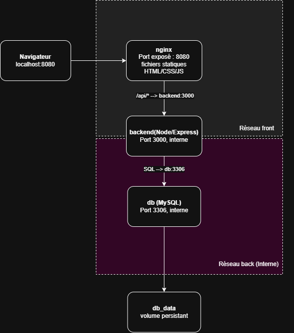

# Event-Form

Application web de gestion d'inscriptions à un événement (CRUD), virtualisée en **3 conteneurs Docker** orchestrés par **Docker Compose**.

[](https://github.com/Ruben-rtc/Event-Form/actions/workflows/ci.yml)

Projet de validation du module **I347 – Utiliser un service avec des conteneurs** (CPNV), réalisé par Arthur Saugy et Ruben ten Cate.

---

## Sommaire

1. [But du projet](#but-du-projet)
2. [Architecture](#architecture)
3. [Lancement](#lancement)
4. [API](#api)
5. [Réseau](#réseau)
6. [Variables d'environnement](#variables-denvironnement)
7. [Sécurité](#sécurité)
8. [Persistance des données](#persistance-des-données)
9. [Dockerfiles](#dockerfiles)
10. [Tests et qualité](#tests-et-qualité)
11. [Versioning](#versioning)
12. [Problèmes rencontrés](#problèmes-rencontrés)
13. [Pistes d'amélioration](#pistes-damélioration)

---

## But du projet

Le but est de conteneuriser une application composée de plusieurs services, en tenant compte du réseau, de la sécurité, de la persistance et de la qualité.

Plutôt que de conteneuriser un logiciel existant, nous avons développé une petite application d'inscription à un événement. Elle permet de :

- **créer** une inscription depuis un formulaire ;
- **consulter** la liste des inscriptions ;
- **modifier** une inscription ;
- **supprimer** une inscription.

| Couche | Technologie |
|---|---|
| Frontend | HTML, CSS, JavaScript vanilla, servis par nginx |
| Backend | API REST Node.js 22 + Express 5 |
| Base de données | MySQL 8.4 |

---

## Architecture



| Service | Image | Rôle | Port | Réseaux |
|---|---|---|---|---|
| `nginx` | `nginxinc/nginx-unprivileged:alpine` + Dockerfile | Sert le site et relaie `/api/*` vers le backend | **8080 publié** | `front` |
| `backend` | `node:22-alpine` + Dockerfile | API REST | 3000 (interne) | `front`, `back` |
| `db` | `mysql:8.4` | Stockage des inscriptions | 3306 (interne) | `back` |

**nginx est le seul point d'entrée.** Il sert les fichiers statiques et transmet toutes les requêtes `/api/*` à `backend:3000` (reverse proxy). Le navigateur ne parle qu'à une seule origine, ce qui évite les problèmes de CORS.

Le schéma de la base est décrit dans [diagramme_BD.md](diagramme_BD.md).

### Structure du projet

```
Event-Form/
<<<<<<< HEAD
├── .github/workflows/ci.yml # Pipeline GitHub Actions (tests)
=======
>>>>>>> 45d642c07152afa4290fd2b3b27fb17d744344c9
├── docker-compose.yaml      # Orchestration des 3 services
├── .env.example             # Modèle des variables d'environnement
├── form-database.sql        # Création de la table + données de test
├── test.sh                  # Tests automatisés de la stack
├── Frontend/
│   ├── Dockerfile           # Image nginx non-root
│   ├── nginx.conf           # Fichiers statiques + reverse proxy /api
│   └── *.html, *.js, style.css
└── backend/
    ├── Dockerfile           # Image Node.js non-root
    ├── eslint.config.js     # Configuration du linter
<<<<<<< HEAD
    ├── app.js               # Application Express (importée par les tests)
    ├── index.js             # Point d'entrée : démarre le serveur
    ├── routes/forms.js      # Routes de l'API
    ├── db/db-forms.js       # Requêtes SQL
    └── tests/
        ├── unit/            # Tests unitaires (base simulée)
        └── integration/     # Tests de la stack Docker
=======
    ├── index.js             # Point d'entrée Express
    ├── routes/forms.js      # Routes de l'API
    └── db/db-forms.js       # Requêtes SQL
>>>>>>> 45d642c07152afa4290fd2b3b27fb17d744344c9
```

---

## Lancement

**Prérequis :** Docker Desktop (ou Docker Engine + Compose v2) et Git.

```bash
git clone https://github.com/Ruben-rtc/Event-Form.git
cd Event-Form

# Créer le fichier d'environnement, puis adapter les mots de passe
cp .env.example .env          # PowerShell : Copy-Item .env.example .env

# Construire les images et démarrer la stack
docker compose up -d --build

# Vérifier l'état : db doit être "healthy"
docker compose ps
```

L'application est disponible sur **http://localhost:8080**.

| Action | Commande |
|---|---|
| Voir les logs | `docker compose logs -f` |
| Arrêter (données conservées) | `docker compose down` |
| Arrêter et **supprimer les données** | `docker compose down -v` |

---

## API

Toutes les routes sont préfixées par `/api/event-form`.

| Méthode | Route | Action | Réponse |
|---|---|---|---|
| `GET` | `/` | Lister les inscriptions | `200` |
| `GET` | `/:id` | Lire une inscription | `200` ou `404` |
| `POST` | `/add` | Créer une inscription | `201` |
| `PUT` | `/edit/:id` | Modifier une inscription | `200` |
| `DELETE` | `/delete/:id` | Supprimer une inscription | `200` ou `404` |

Corps JSON attendu pour `POST` et `PUT` :

```json
{ "name": "Ruben", "surname": "ten Cate", "email": "ruben@exemple.ch", "message": "Bonjour" }
```

---

## Réseau

Les conteneurs sont répartis sur **deux réseaux personnalisés** :

| Réseau | Conteneurs | Type | Rôle |
|---|---|---|---|
| `front` | nginx, backend | bridge | nginx → API |
| `back` | backend, db | bridge **`internal: true`** | API → base de données |

- Le **backend** est le seul conteneur présent dans les deux réseaux. **nginx ne peut donc pas joindre la base de données.**
- Le réseau `back` est **interne** : ses conteneurs n'ont aucun accès à Internet.
- Les conteneurs se trouvent par leur **nom de service** (`backend`, `db`) grâce au DNS de Docker.
- Seul le port **8080** est publié sur la machine hôte. Les ports 3000 et 3306 ne sont joignables qu'à l'intérieur des réseaux Docker.

Dans `docker network ls`, les réseaux apparaissent sous les noms `event-form_front` et `event-form_back` : Compose ajoute le nom du projet devant.

---

## Variables d'environnement

Les variables sont définies dans un fichier `.env` à la racine. Ce fichier est **exclu de Git** (`.gitignore`) ; seul le modèle `.env.example` est versionné.

| Variable | Exemple | Utilisée par | Description |
|---|---|---|---|
| `DB_HOST` | `db` | backend | Nom du service MySQL |
| `DB_PORT` | `3306` | backend | Port **interne** de MySQL |
| `DB_NAME` | `form_database` | db, backend | Nom de la base |
| `DB_USER` | `userXX` | db, backend | Utilisateur applicatif |
| `DB_PASSWORD` | `passwordXX` | db, backend | Mot de passe de l'utilisateur applicatif |
| `DB_ROOT_PASSWORD` | `passwordXX` | db | Mot de passe root de MySQL |
| `PORT` | `3000` | backend | Port d'écoute de l'API |

> ⚠️ Les variables `DB_NAME`, `DB_USER`, `DB_PASSWORD` et `DB_ROOT_PASSWORD` ne sont appliquées par MySQL **qu'à la création du volume**. Après les avoir modifiées, il faut recréer le volume avec `docker compose down -v`.

---

## Sécurité

| Mesure | Mise en œuvre |
|---|---|
| Secrets hors du code | Identifiants dans `.env`, exclu de Git et des images (`.dockerignore`) |
| Utilisateurs non-root | backend : `node` (uid 1000) · nginx : `nginx` (uid 101) · MySQL : `mysql` (géré par l'image officielle) |
| Code en lecture seule | Les fichiers du backend appartiennent à root : l'application peut les lire mais pas les modifier |
| Ports fermés | Seul le 8080 est publié ; l'API et la base sont internes |
| Isolation de la base | Réseau `back` interne, non accessible depuis nginx ni depuis Internet |
| Injections SQL | Toutes les requêtes sont paramétrées (`?`) |
| XSS | Le frontend affiche les données avec `textContent`, jamais `innerHTML` |

---

## Persistance des données

Les données MySQL sont stockées dans le **volume nommé `db_data`**, monté sur `/var/lib/mysql`.

**Pourquoi un volume nommé plutôt qu'un dossier de la machine (bind mount) ?**

- Docker gère lui-même son emplacement et ses droits, sans dépendre de l'arborescence de l'hôte.
- Il fonctionne de la même façon sous Windows, macOS et Linux.
- Les données survivent à `docker compose down` et à la reconstruction des images ; seul `docker compose down -v` les supprime.

Le fichier `form-database.sql` est monté **en lecture seule** dans `/docker-entrypoint-initdb.d/`. MySQL l'exécute **au premier démarrage uniquement**, pour créer la table `form_data` et insérer deux inscriptions de test.

**Démarrage ordonné :** un healthcheck vérifie toutes les 5 secondes que MySQL répond (`mysqladmin ping`). Le backend ne démarre que lorsque la base est `healthy` (`depends_on: condition: service_healthy`).

---

## Dockerfiles

### `backend/Dockerfile`

- Image de base **`node:22-alpine`**, légère.
<<<<<<< HEAD
- `npm ci --omit=dev` : installation reproductible depuis `package-lock.json`, sans les dépendances de développement (ESLint, supertest…).
- `package*.json` est copié **avant** le code, pour que la couche des dépendances reste en cache tant qu'elles ne changent pas.
- `.dockerignore` exclut `node_modules`, `.env` et le dossier `tests`, qui n'ont rien à faire dans l'image.
=======
- `npm ci --omit=dev` : installation reproductible depuis `package-lock.json`, sans les dépendances de développement (ESLint…).
- `package*.json` est copié **avant** le code, pour que la couche des dépendances reste en cache tant qu'elles ne changent pas.
- `.dockerignore` exclut `node_modules` et `.env`.
>>>>>>> 45d642c07152afa4290fd2b3b27fb17d744344c9
- `USER node` : l'application tourne sans les droits root.

### `Frontend/Dockerfile`

- Image **`nginxinc/nginx-unprivileged:alpine`** : nginx officiel préconfiguré pour tourner sans root.
- Écoute sur le port **8080**, car un utilisateur non-root ne peut pas ouvrir un port inférieur à 1024.
- Seuls les fichiers nécessaires au site sont copiés.

---

## Tests et qualité

<<<<<<< HEAD
Le projet est testé à trois niveaux :

| Niveau | Outil | Ce qui est testé | Docker nécessaire |
|---|---|---|---|
| Tests unitaires | `node:test` + supertest | Chaque route de l'API, avec une base de données simulée | Non |
| Tests d'intégration | `node:test` + `fetch` | La vraie stack (nginx → backend → MySQL), à travers nginx | Oui |
| Test de la stack | `test.sh` | CRUD, persistance après redémarrage, utilisateurs non-root | Oui |

Les tests unitaires et d'intégration sont lancés automatiquement par **GitHub Actions** (voir plus bas).

=======
>>>>>>> 45d642c07152afa4290fd2b3b27fb17d744344c9
### Linter

ESLint (configuration recommandée, environnement Node.js) vérifie le code du backend :

```bash
cd backend
npm install
npm run lint
```

**Résultat :** au premier lancement, ESLint a détecté 2 variables inutilisées (`router` dans `index.js`, `rows` dans `db-forms.js`). Après correction : **0 erreur, 0 avertissement**.

<<<<<<< HEAD
### Tests unitaires (backend)

Les tests se trouvent dans `backend/tests/unit/`. Ils utilisent le lanceur de tests intégré à Node.js (`node:test`) et **supertest**, qui envoie des requêtes HTTP à l'application Express sans démarrer de serveur.

La base de données est **simulée** (`mock.method`) : chaque test décide de ce que renvoie la base, ce qui permet de tester aussi les cas d'erreur (base indisponible → `500`). Ces tests n'ont donc besoin ni de Docker ni de MySQL.

Pour que les tests puissent importer l'application, elle est définie dans `app.js` ; `index.js` se contente de la démarrer avec `app.listen()`.

```bash
cd backend
npm install
npm test
```

| Route | Cas testés |
|---|---|
| `GET /` | Liste des inscriptions, liste vide, erreur de la base (`500`) |
| `GET /:id` | Inscription trouvée (id converti en nombre), inexistante (`404`), erreur (`500`) |
| `POST /add` | Création (`201`, message de confirmation), erreur (`500`) |
| `PUT /edit/:id` | Modification avec les bonnes valeurs, erreur (`500`) |
| `DELETE /delete/:id` | Suppression, inscription inexistante (`404`), erreur (`500`) |
| Route inconnue | `404` |

**Résultat :** 14 tests, **14 réussis**, 0 échec.

### Tests d'intégration

Les tests se trouvent dans `backend/tests/integration/`. Ils interrogent la stack démarrée avec Docker Compose **en passant par nginx** (`http://localhost:8080`), exactement comme le navigateur.

```bash
# 1. À la racine du projet : démarrer la stack
docker compose up -d --build --wait

# 2. Dans backend/ : lancer les tests
cd backend
npm install
npm run test:integration
```

L'adresse testée peut être changée avec la variable `BASE_URL` (par défaut `http://localhost:8080`).

| Catégorie | Vérifications |
|---|---|
| Frontend | Les pages d'accueil et de liste répondent ; `/form/1` renvoie bien `form.html` |
| Données initiales | Les deux inscriptions de `form-database.sql` sont présentes |
| CRUD | Création, lecture (avec la date remplie par MySQL), modification, suppression, puis `404` |
| Erreurs | Un id inexistant renvoie `404`, une double suppression aussi |
| Isolation réseau | Les ports 3306 (MySQL) et 3000 (backend) ne sont **pas** accessibles depuis la machine hôte |

Les tests créent leur propre inscription et la suppriment à la fin.

> Si un serveur MySQL est installé directement sur ta machine, le test du port 3306 échouera : le port est alors occupé par ce MySQL local, pas par Docker.

**Résultat :** 12 tests, **12 réussis**, 0 échec.

### Script de test de la stack (`test.sh`)
=======
### Tests automatisés
>>>>>>> 45d642c07152afa4290fd2b3b27fb17d744344c9

Le script `test.sh` démarre la stack et teste son fonctionnement réel, à travers nginx. À lancer depuis la racine, sous Linux, macOS ou **Git Bash** sous Windows :

```bash
./test.sh
```

| Catégorie | Vérifications |
|---|---|
| Frontend | Les pages d'accueil et de liste répondent |
| CRUD | Création, lecture, modification, suppression, puis `404` sur l'inscription supprimée |
| Persistance | L'inscription existe toujours après `docker compose down` puis `up` |
| Sécurité | backend et nginx ne tournent pas en root ; nginx ne peut pas joindre la base |

Le script renvoie un code de sortie non nul en cas d'échec. Il crée sa propre inscription et la supprime à la fin, sans toucher aux autres données.

**Résultat :**

```
== Frontend
  [OK]    Page d'accueil
  [OK]    Page liste
== CRUD
  [OK]    POST /add crée l'inscription 3
  [OK]    GET /3
  [OK]    PUT /edit/3
  [OK]    La modification est enregistrée
== Persistance (down puis up, sans -v)
  [OK]    L'inscription 3 existe après redémarrage
== Suppression
  [OK]    DELETE /delete/3
  [OK]    GET /3 après suppression
== Sécurité
  [OK]    backend tourne en non-root (uid 1000)
  [OK]    nginx tourne en non-root (uid 101)
  [OK]    nginx ne peut pas joindre la base de données

Résultat : 12 réussi(s), 0 échec(s)
```

Pour vérifier que les tests de sécurité détectent bien un problème, nous avons volontairement ajouté nginx au réseau `back` : le script a signalé « nginx peut joindre la base de données » et s'est terminé en erreur.

<<<<<<< HEAD
### Intégration continue (GitHub Actions)

Le workflow [`.github/workflows/ci.yml`](.github/workflows/ci.yml) se lance automatiquement à chaque **push** et à chaque **pull request** vers `main` ou `develop`. Il peut aussi être lancé à la main depuis l'onglet **Actions** du dépôt.

| Job | Étapes |
|---|---|
| **1. Tests unitaires** | Installation de Node.js 22 → `npm ci` → `npm test` |
| **2. Tests d'intégration** (seulement si le job 1 réussit) | Copie de `.env.example` en `.env` → vérification de `docker-compose.yaml` → `docker compose up -d --build --wait` → `npm run test:integration` → affichage des logs en cas d'échec → `docker compose down -v` |

Le vrai fichier `.env` n'étant pas sur GitHub, le pipeline utilise le modèle `.env.example`.

Le résultat de chaque exécution est visible dans l'onglet **Actions** du dépôt, et directement sur chaque pull request : une pull request dont les tests échouent est signalée avant d'être fusionnée.

=======
>>>>>>> 45d642c07152afa4290fd2b3b27fb17d744344c9
### Tests manuels

L'API a aussi été testée avec **Postman** et depuis le frontend.

---

## Versioning

- Le projet est hébergé sur GitHub : [Ruben-rtc/Event-Form](https://github.com/Ruben-rtc/Event-Form).
- Branches : `main` (version stable), `develop` (intégration), une branche par fonctionnalité (`backend`, `Frontend`, `securite-reseau`, `test-linter`…).
- Chaque fonctionnalité est intégrée par **pull request** vers `develop`, puis `develop` vers `main`.
- Les versions sont marquées par des tags Git (`v1`).

---

## Problèmes rencontrés

| Problème | Cause | Solution |
|---|---|---|
| MySQL redémarrait en boucle (`Cannot downgrade from 260700 to 80411`) | Le volume avait été créé par une version plus récente de MySQL | Version de l'image figée (`mysql:8.4` au lieu de `latest`) et volume recréé |
| `ECONNREFUSED` sur le port 3307 | `DB_PORT` valait 3307 ; entre conteneurs, on utilise le port **interne** | `DB_PORT=3306` |
| `Host … is not allowed to connect` | Les identifiants du `.env` avaient changé après la création du volume | Volume recréé avec `docker compose down -v` |
| Le backend démarrait avant que MySQL soit prêt | `depends_on` simple n'attend que le démarrage du conteneur | Healthcheck + `condition: service_healthy` |
| `TLS handshake timeout` lors du téléchargement des images | Réseau de l'école lent ou filtré | Téléchargement via VPN ; l'image reste ensuite en cache |

---

## Pistes d'amélioration

<<<<<<< HEAD
- **Compléter le pipeline GitHub Actions** avec `npm run lint` et `./test.sh` (persistance, utilisateurs non-root).
=======
- **Pipeline GitHub Actions** lançant `npm run lint` et `./test.sh` à chaque push.
>>>>>>> 45d642c07152afa4290fd2b3b27fb17d744344c9
- **Publication des images** sur GitHub Container Registry (GHCR), pour lancer le projet sans reconstruire.
- **Validation des entrées** dans l'API : renvoyer `400` pour un champ vide ou un id invalide, `404` sur un `PUT` vers une inscription inexistante.
- **Healthcheck du backend** (route `/api/health`) pour que nginx attende aussi l'API.
- **Dockerfile multistage** pour le backend. Le gain est faible ici, car il n'y a pas d'étape de compilation.
- **Restreindre root à MySQL** avec `MYSQL_ROOT_HOST: localhost`.
- **Versions figées** pour toutes les images (par exemple `nginx-unprivileged:1.30-alpine`).

---

## Licence

Projet distribué sous licence [Apache 2.0](LICENSE).
